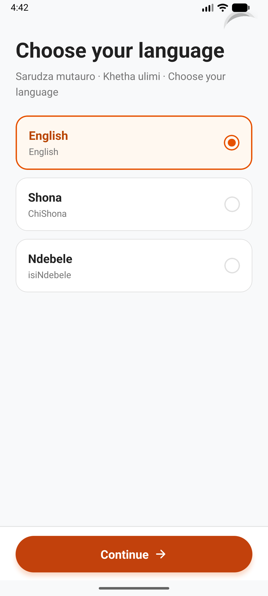
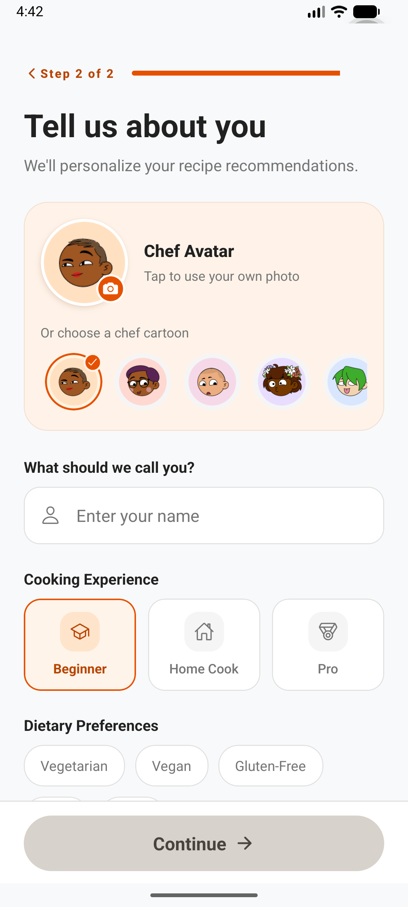
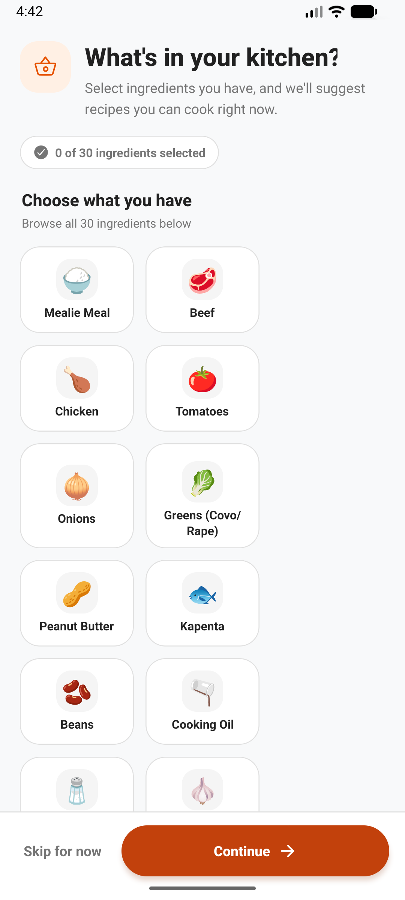
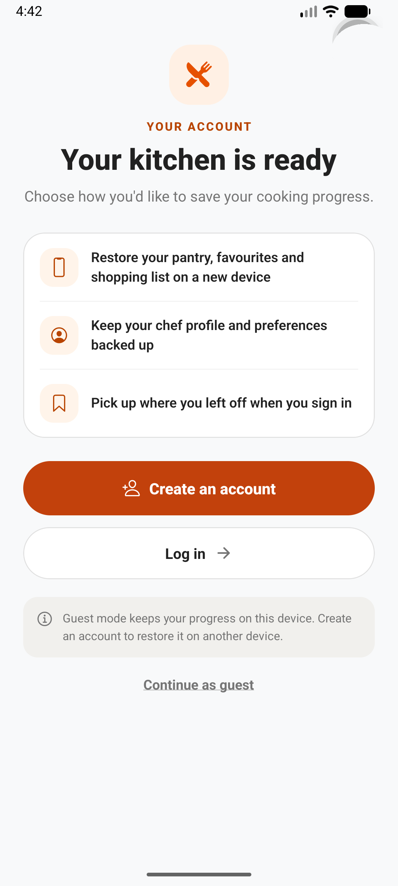

<div align="center">


# Zimbabwe Traditional Recipes

**Discover Zimbabwean food. Cook with what you have. Keep the stories alive.**

[](https://github.com/PraiseTechzw/recipe/actions/workflows/ci.yml)
[](https://github.com/PraiseTechzw/recipe/actions/workflows/pages.yml)
[](LICENSE)
[](https://expo.dev/)
[](https://play.google.com/store/apps/details?id=com.appixiasoftwares.tasteofzimbabwe)

[Website](https://praisetechzw.github.io/recipe/) · [Support](https://praisetechzw.github.io/recipe/support/) · [Privacy](https://praisetechzw.github.io/recipe/privacy/) · [Terms](https://praisetechzw.github.io/recipe/terms/)

</div>

Zimbabwe Traditional Recipes is an Android and iOS recipe app by Praise Masunga (PraiseTechzw). Browse Zimbabwean dishes, organize a pantry, save recipes, follow cooking steps, and ask the AI Chef for ingredient-based ideas. The app supports English, ChiShona, and isiNdebele.

## A look inside

Screenshots below were captured from the Android emulator running the app.

<div align="center">
  
  
  
  
</div>

## What you can do

- Browse and search Zimbabwean recipes, save favourites, and follow guided cooking steps.
- Select pantry ingredients to find dishes you can make with what is available.
- Create a profile, choose a language, and track cooking progress and achievements.
- Use AI Chef for recipe suggestions and ingredient-image assistance. AI results can be incomplete; review ingredients and food-safety details before cooking.
- Continue as a guest with device-local progress or create an account to sync selected app data through Supabase.

The app uses OpenRouter through a Supabase Edge Function. Its provider/model availability can change. The app does not sell subscriptions or in-app purchases at this time.

## Technology

| Area | Implementation |
|---|---|
| Mobile app | React Native, Expo SDK 58, TypeScript, Expo Router |
| State | Zustand and AsyncStorage |
| Backend | Supabase Auth, Postgres, Storage, Realtime, Edge Functions |
| AI | OpenRouter `openrouter/free`, accessed server-side |
| Languages | English, ChiShona, isiNdebele |

## Run locally

### Requirements

- Node.js 20 or later and npm
- Expo Go for a quick local preview, or Android Studio/Xcode for a native build
- A Supabase project for account, cloud sync, and AI features

### Setup

```bash
git clone https://github.com/PraiseTechzw/recipe.git
cd recipe
npm ci
cp .env.example .env
```

Set the public Supabase values in `.env`:

```dotenv
EXPO_PUBLIC_SUPABASE_URL=https://YOUR_PROJECT.supabase.co
EXPO_PUBLIC_SUPABASE_PUBLISHABLE_KEY=YOUR_SUPABASE_PUBLISHABLE_KEY
```

Start the app:

```bash
npx expo start
```

For a local Supabase stack, install the [Supabase CLI](https://supabase.com/docs/guides/cli) and Docker, then run:

```bash
supabase start
supabase db reset
supabase functions serve openrouter-completion --env-file .env.local
```

The timestamped migrations in `supabase/migrations/` define the database in order; `supabase/seed.sql` adds the initial public chef and recipe data. For a hosted project, review pending changes first with `supabase db push --dry-run`. Set the AI key only as a Supabase secret:

```bash
supabase functions deploy openrouter-completion
supabase secrets set OPENROUTER_API_KEY=YOUR_OPENROUTER_API_KEY
```

Never put the OpenRouter key in an `EXPO_PUBLIC_*` variable or commit secrets. For account seeding and hosted auth setup, see [Supabase setup](supabase/README.md).

For EAS builds, set `EXPO_PUBLIC_SUPABASE_URL` and `EXPO_PUBLIC_SUPABASE_PUBLISHABLE_KEY` in the EAS **production** environment. The legacy `EXPO_PUBLIC_SUPABASE_ANON_KEY` name remains supported. Increment both app/package versions with `npm run bump-version`, then run `npm run eas-build:local` for a local Android production App Bundle or `npm run eas-build` for an EAS cloud build. See [EAS environment setup](docs/eas-build.md).

## Project documentation

- [Production release checklist](docs/release-checklist.md)
- [Store listing review and suggested copy](docs/store-listing.md)
- [Update prompt and release process](docs/updates.md)
- [EAS Android build and environment setup](docs/eas-build.md)
- [Architecture and backend setup](supabase/README.md)
- [Privacy policy](docs/legal/privacy-policy.md) · [Terms of Service](docs/legal/terms-of-service.md)
- [Contributing](CONTRIBUTING.md) · [Code of Conduct](CODE_OF_CONDUCT.md)

## Contributing

Bug reports, documentation fixes, and pull requests are welcome. Please read [CONTRIBUTING.md](CONTRIBUTING.md) and the [Code of Conduct](CODE_OF_CONDUCT.md) before contributing.

## License and attribution

Source code is released under the [MIT License](LICENSE). The chef avatar artwork uses DiceBear Adventurer by Lisa Wischofsky under [CC BY 4.0](https://creativecommons.org/licenses/by/4.0/). Third-party recipe images and data retain their respective attribution and licensing terms.

## Contact

**Praise Masunga · PraiseTechzw**  
[praisetechzw@gmail.com](mailto:praisetechzw@gmail.com) · [GitHub](https://github.com/PraiseTechzw)
